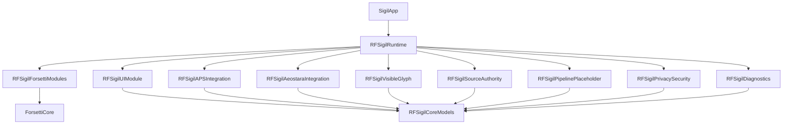
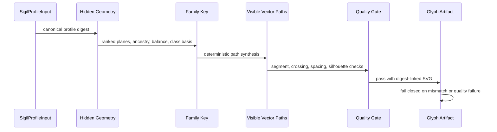

# Sigil

Sigil is a native Apple-platform project in pre-alpha. The current implementation is the Phase 1 foundation: a Forsetti-backed modular runtime, one SwiftUI dashboard module, source-authority gateways, local-only diagnostics, privacy guardrails, and a bounded deterministic visible-glyph service.

The repository is intentionally foundation-first. It exposes verified status surfaces and local artifact generation without implementing the full identity pipeline, lore generation, export bundles, analytics, backend upload, or personal-data network flows.

## Product Direction And Roadmap

The [current project plan](docs/project-plan.md) and [product roadmap](docs/roadmap.md) govern planned work. Sigil's canonical form must derive from ASH cosmological mathematics; the existing bounded local generator is not evidence that the final ASH identity pipeline is complete.

The owner has [removed the additional personal-data embedding requirement](docs/decisions/2026-10-10-no-personal-data-embedding.md). The Sigil need not carry a recoverable personal record. Personal input, internal mathematical geometry, PersonalCodex, deterministic generation, integrity/safety checks, and canonical/Flare separation remain in scope. Do not reintroduce the removed feature as a mandatory hidden payload or sidecar.

The next approved engineering action is a read-only source trace from `SigilVisibleGlyphService.makeHiddenGeometry(for:)` to the governing ASH mathematics, canonical data, and referenced binary artifacts. A concrete code change follows the evidence; this documentation update does not implement that change or authorize a broad framework rewrite. Analytics and application-backend/personal-data upload features are excluded by the product privacy boundary, not scheduled for a later phase.

## Current Status

| Area | State |
| --- | --- |
| Version | `PA.0.1.0` |
| Stage | Pre-alpha |
| Primary platform | iOS 17+ |
| Package validation | SwiftPM on macOS 14+ |
| Runtime modules | 1 SwiftUI UI module, 7 service modules |
| Visible glyphs | Deterministic local service with quality gates and digest validation |
| Privacy posture | Local-only diagnostics, no analytics SDK, no backend endpoint |
| Release governance | Version, changelog, attribution, and project guardrails |

## Architecture



The runtime is composed through public Forsetti module registration. `RFSigilUIModule` owns the single dashboard surface. Service modules publish bounded status, evidence, validation, and local artifact behavior.

## Runtime Modules

| Module | Role | Capability posture |
| --- | --- | --- |
| `RFSigilUIModule` | SwiftUI Phase 1 dashboard | View injection only |
| `RFSigilAPSIntegration` | APS evidence and conformance gateway | No network, telemetry, or API capability |
| `RFSigilAeostaraIntegration` | Aeostara platform and baseline gateway | No network, telemetry, or API capability |
| `RFSigilVisibleGlyph` | Local visible-glyph artifact service | No network, telemetry, or API capability |
| `RFSigilSourceAuthority` | Source hierarchy and boundary reporting | No network, telemetry, or API capability |
| `RFSigilPipelinePlaceholder` | Explicit unavailable pipeline response | No network, telemetry, or API capability |
| `RFSigilPrivacySecurity` | Local-first privacy status | Security capability only |
| `RFSigilDiagnostics` | Local diagnostic aggregation | Diagnostics capability only |

## Visible Glyph Foundation

The visible-glyph service accepts a `SigilProfileInput`, derives hidden canonical geometry, produces a `SigilFamilyKey`, synthesizes visible vector paths, evaluates quality, renders SVG, and validates digest linkage before returning an artifact.



The canonical identity data and presentation styling remain separate. `SigilFlarePresentation` can change visual style metadata without mutating canonical digests or vector path data.

## Repository Layout

| Path | Purpose |
| --- | --- |
| `Sources/` | Swift package targets and app source |
| `Tests/SigilTests/` | Swift runtime, module, dashboard, source, privacy, and visible-glyph tests |
| `Tests/*GuardTests/` | Python tests for repository guard scripts |
| `docs/` | Maintainer documentation |
| `evidence/` | Phase evidence captured during implementation |
| `ProjectEvidence/` | Project-level guardrail, build, source, and visible-glyph evidence |
| `scripts/` | Local verification scripts |
| `tools/sigil_guardrails/` | Strict repository guardrail validator |

## Verification

Run the local verification wrapper before publishing changes:

```bash
bash scripts/verify-sigil-guardrails.sh
```

Useful focused checks:

```bash
swift test
python3 scripts/attribution_guard.py --branch "$(git branch --show-current)" --repo-root .
python3 scripts/version_guard.py --repo-root .
python3 tools/sigil_guardrails/verify_sigil_guardrails.py --project-root . --policy tools/sigil_guardrails/sigil_guardrail_policy.json --strict
```

Current Phase 1 verification evidence records 22 Swift tests with 0 failures, passing repository guardrails, passing attribution guard, passing version guard, and successful configured Xcode simulator validation for `SigilApp`.

## Version And Changelog

Sigil uses:

```text
STAGE.major.feature.patch
```

The current stage prefix is `PA` for pre-alpha. `VERSION` is the source of truth for the current version, and `CHANGELOG.md` must contain an entry matching that version. Material repository changes must include a changelog update.

## Boundaries

The following are intentionally unavailable in the current phase:

- Full identity pipeline
- Standard numerology and final life-path calculations
- Celestial name generation
- WRW lore generation
- Personal artifact package generation
- Sigil Flare export or editor workflows
- Final export bundle generation
- Analytics, backend upload, or personal-data network flows

The visible-glyph service is bounded local foundation work, not the final pipeline.

## Documentation

- [Project Plan](docs/project-plan.md)
- [Product Roadmap](docs/roadmap.md)
- [No Personal-Data Embedding Decision](docs/decisions/2026-10-10-no-personal-data-embedding.md)
- [Architecture](docs/architecture.md)
- [Visible Glyph Engine](docs/visible-glyph-engine.md)
- [Verification](docs/verification.md)
- [Version Policy](docs/release/version-policy.md)
- [Phase 1 Implementation Plan](docs/phase1/implementation-plan.md)

A project wiki is not currently available for this repository; the documentation pages above are the current reference set.
