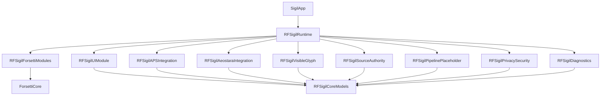
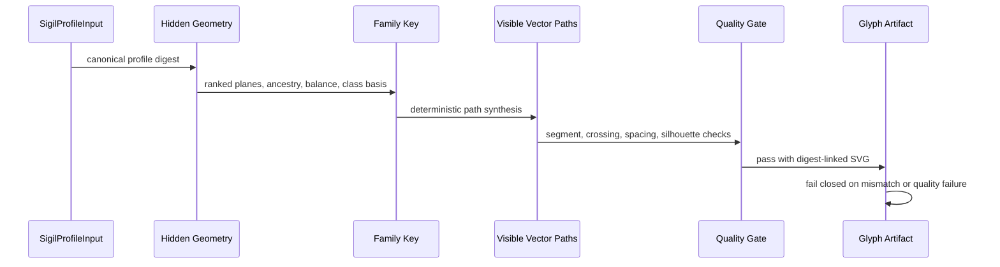

# Sigil

Sigil is a native Apple-platform project in pre-alpha. The current implementation is the Phase 1 foundation: a Forsetti-backed modular runtime, one SwiftUI dashboard module, source-authority gateways, local-only diagnostics, privacy guardrails, and a bounded deterministic visible-glyph service.

The repository is intentionally foundation-first. It exposes verified status surfaces, the standard numerology and ASH/APS identity resolution, and local artifact generation; the final ASH glyph materialization, lore generation, export bundles, analytics, backend upload, and personal-data network flows remain out of scope.

## Product Direction And Roadmap

The [current project plan](docs/project-plan.md) and [product roadmap](docs/roadmap.md) govern planned work. Sigil's canonical form must derive from ASH cosmological mathematics. Package 02 delivered the standard numerology bridge and the source-backed ASH/APS state/orbit/classification resolution. Package 03 delivered artifact-health validation over real records, geometry, schemas, and digests and real local-only encrypted persistence with Keychain-backed keys; a failed save is reported as a failure, never a success, and diagnostics never record the record payload, key material, storage path, or identifier. Package 04 delivered the integrity-verified canon resource layer, deterministic celestial naming, and the readable PersonalCodex interpretation. Package 05 delivered the canonical ASH-derived visible glyph: the visible vector paths are now a deterministic branch fan projected from the canonical topology and driven by the profile's decoded ASH state through a product-owned message seam, so the temporary digest-parameterized renderer is gone. Package 06 delivered the native experience on top of the real services: a three-tab app (Dashboard / Create / Records), the input → generate → result journey with a validated draft and a state machine that drops out-of-order completions, the presentation-only Flare editor, and user-selected export/share — wiring the real pipeline and the real secure store into the app. Package 07 (integration and owner handover) remains.

The owner has [removed the additional personal-data embedding requirement](docs/decisions/2026-10-10-no-personal-data-embedding.md). The Sigil need not carry a recoverable personal record. Personal input, internal mathematical geometry, PersonalCodex, deterministic generation, integrity/safety checks, and canonical/Flare separation remain in scope. Do not reintroduce the removed feature as a mandatory hidden payload or sidecar.

The approved read-only source trace from `SigilVisibleGlyphService.makeHiddenGeometry(for:)` to the governing ASH mathematics, canonical data, and referenced binary artifacts is complete; its results are in the [ASH source trace report](docs/ash-trace/source-to-output-map.md). The trace records which relationships are supported, which are evidenced local substitutions, and which remain unresolved owner decisions; it authorizes no implementation. A concrete code change follows the recorded evidence and the owner's decisions on the unresolved items; no framework rewrite is authorized. Analytics and application-backend/personal-data upload features are excluded by the product privacy boundary, not scheduled for a later phase.

## Current Status

| Area | State |
| --- | --- |
| Version | `PA.0.6.1` (build 8) |
| Stage | Pre-alpha |
| Primary platform | iOS 17+ |
| Package validation | SwiftPM on macOS 14+ |
| Runtime modules | 1 SwiftUI UI module, 7 service modules |
| Visible glyphs | Deterministic local service with quality gates and digest validation |
| Identity pipeline | Standard numerology and ASH/APS nine-bit state/orbit/classification resolution implemented; the canonical ASH-derived visible glyph is delivered (Package 05) |
| Artifact health | Aeostara base-lifecycle validation over real records, geometry, schemas, and digests; fail-closed and non-destructive, with safe recovery of derivable metadata |
| Secure persistence | Local-only AES-GCM (CryptoKit) with Keychain-backed keys stored separately from ciphertext; atomic replace preserves the last-verified record; a failed save is reported as a failure, never a success ([docs](docs/design/secure-local-storage.md)) |
| Privacy posture | Local-only diagnostics, no analytics SDK, no backend endpoint |
| Diagnostics | Bounded local capture with redaction before persistence, correlated failure incidents, and a paired detailed JSON/Markdown export ([docs](docs/diagnostics.md)) |
| Release governance | Version, changelog, attribution, and project guardrails |

## Architecture



The runtime is composed through public Forsetti module registration. `RFSigilUIModule` owns the single dashboard surface. Service modules publish bounded status, evidence, validation, and local artifact behavior.

## Runtime Modules

| Module | Role | Capability posture |
| --- | --- | --- |
| `RFSigilUIModule` | SwiftUI Phase 1 dashboard | View injection only |
| `RFSigilAPSIntegration` | APS evidence and conformance gateway | No network, telemetry, or API capability |
| `RFSigilAeostaraIntegration` | Aeostara platform and baseline gateway | No network, telemetry, or API capability |
| `RFSigilVisibleGlyph` | Local visible-glyph artifact service | No network, telemetry, or API capability |
| `RFSigilSourceAuthority` | Source hierarchy and boundary reporting | No network, telemetry, or API capability |
| `RFSigilPipelinePlaceholder` | Explicit unavailable pipeline response | No network, telemetry, or API capability |
| `RFSigilPrivacySecurity` | Local-first privacy status | Security capability only |
| `RFSigilDiagnostics` | Local diagnostic aggregation | Diagnostics capability only |

## Visible Glyph Foundation

The visible-glyph service accepts a `SigilProfileInput`, derives hidden canonical geometry, produces a `SigilFamilyKey`, synthesizes visible vector paths, evaluates quality, renders SVG, and validates digest linkage before returning an artifact.



The canonical identity data and presentation styling remain separate. `SigilFlarePresentation` can change visual style metadata without mutating canonical digests or vector path data.

## Repository Layout

| Path | Purpose |
| --- | --- |
| `Sources/` | Swift package targets and app source |
| `Tests/SigilTests/` | Swift runtime, module, dashboard, source, privacy, and visible-glyph tests |
| `Tests/*GuardTests/` | Python tests for repository guard scripts |
| `docs/` | Maintainer documentation |
| `evidence/` | Phase evidence captured during implementation |
| `ProjectEvidence/` | Project-level guardrail, build, source, and visible-glyph evidence |
| `scripts/` | Local verification scripts |
| `tools/sigil_guardrails/` | Strict repository guardrail validator |

## Verification

Run the local verification wrapper before publishing changes:

```bash
bash scripts/verify-sigil-guardrails.sh
```

Useful focused checks:

```bash
swift test
python3 scripts/attribution_guard.py --branch "$(git branch --show-current)" --repo-root .
python3 scripts/version_guard.py --repo-root .
python3 tools/sigil_guardrails/verify_sigil_guardrails.py --project-root . --policy tools/sigil_guardrails/sigil_guardrail_policy.json --strict
```

Current verification: 137 Swift package tests with 0 failures, strict repository guardrails, attribution guard, and version guard passed, with the Xcode project aligned to `PA.0.6.1` / build 8 (fresh 2026-11-07 run: 137/137 package tests; strict guardrail wrapper including `swift test --parallel` and `xcodebuild -list`; a release-configuration build confirms the development diagnostic capture is compiled out of the distributable configuration; see [docs/verification.md](docs/verification.md)).

## Version And Changelog

Sigil uses:

```text
STAGE.major.feature.patch
```

The current stage prefix is `PA` for pre-alpha. `VERSION` is the source of truth for the current version, and `CHANGELOG.md` must contain an entry matching that version. Material repository changes must include a changelog update.

## Boundaries

The following are intentionally unavailable in the current phase:

- Full identity pipeline
- Standard numerology and final life-path calculations
- Celestial name generation
- WRW lore generation
- Personal artifact package generation
- Sigil Flare export or editor workflows
- Final export bundle generation
- Analytics, backend upload, or personal-data network flows

The visible-glyph service is bounded local foundation work, not the final pipeline.

## Documentation

- [Project Plan](docs/project-plan.md)
- [Product Roadmap](docs/roadmap.md)
- [ASH Source Trace](docs/ash-trace/source-to-output-map.md) (map, trace ledger, findings and next change, verification cases)
- [ASH-Trace Handoff](docs/handoffs/ash-trace.md)
- [No Personal-Data Embedding Decision](docs/decisions/2026-10-10-no-personal-data-embedding.md)
- [Architecture](docs/architecture.md)
- [Visible Glyph Engine](docs/visible-glyph-engine.md)
- [Secure Local Storage](docs/design/secure-local-storage.md) (encrypted-at-rest design and failure semantics)
- [Verification](docs/verification.md)
- [Version Policy](docs/release/version-policy.md)
- [Phase 1 Implementation Plan](docs/phase1/implementation-plan.md)

The project wiki provides the narrative architecture, module map, visual evidence, and release governance pages for broader review; the repository documentation pages above remain the authoritative reference.
