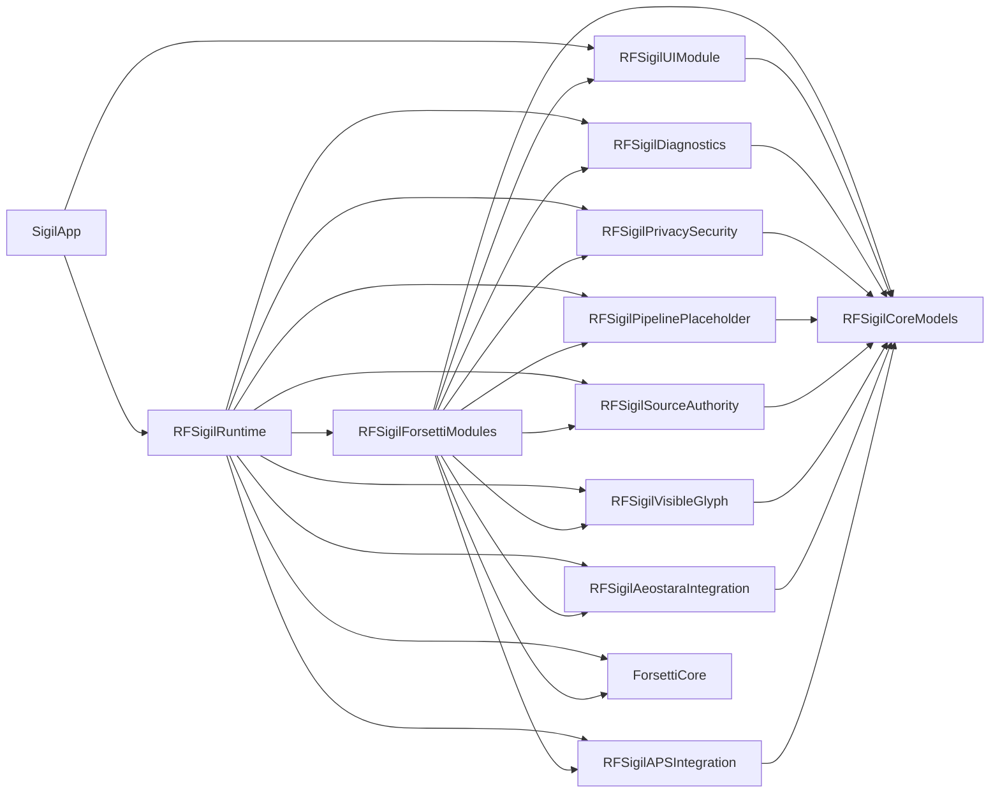
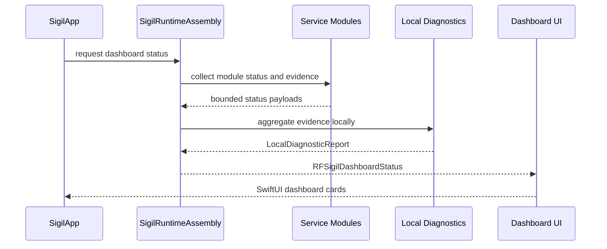

# Sigil Architecture

## Purpose

Sigil Phase 1 establishes the project runtime foundation before the full identity pipeline is implemented. The current architecture provides a native iOS dashboard, public Forsetti module registration, source authority reporting, local diagnostics, privacy posture reporting, and bounded visible-glyph artifact generation.

The architecture is intentionally modular. Each target owns one responsibility and communicates through shared status, evidence, and artifact types in `RFSigilCoreModels`.

## Target Graph

## Runtime Composition

`RFSigilRuntime` builds the dashboard status by composing services and gateways:

1. APS gateway reports source coverage and conformance status.
2. Aeostara gateway reports platform accessibility, baseline pinning, and fail-closed health decisions.
3. Visible-glyph service reports bounded deterministic artifact capability.
4. Source authority service preserves ASH, YWE, APS, WRW, and Sigil layer boundaries.
5. Pipeline placeholder service states that the final pipeline is unavailable.
6. Privacy/security service reports local-only posture.
7. Diagnostics service aggregates evidence locally.
8. Dashboard status is rendered through the single SwiftUI UI module.

## Forsetti Boundary

Sigil consumes Forsetti as a sealed runtime dependency. The project uses public Forsetti APIs for:

- `ModuleDescriptor`
- `ModuleManifest`
- `ModuleRegistry`
- `ForsettiRuntime`
- module capability declarations
- UI contribution descriptors

Sigil does not copy Forsetti internal source trees, patch Forsetti internals, or use private runtime behavior.

## Module Catalog

The catalog registers eight module definitions:

| Module ID | Display name | Type | Capabilities |
| --- | --- | --- | --- |
| `com.ravenforge.sigil.ui` | Sigil Phase 1 Dashboard | UI | `viewInjection` |
| `com.ravenforge.sigil.aps` | Sigil APS Gateway | Service | None |
| `com.ravenforge.sigil.aeostara` | Sigil Aeostara Gateway | Service | None |
| `com.ravenforge.sigil.visible-glyph` | Sigil Visible Glyph | Service | None |
| `com.ravenforge.sigil.source-authority` | Sigil Source Authority | Service | None |
| `com.ravenforge.sigil.pipeline-placeholder` | Sigil Pipeline Placeholder | Service | None |
| `com.ravenforge.sigil.privacy-security` | Sigil Privacy Security | Service | `security` |
| `com.ravenforge.sigil.diagnostics` | Sigil Diagnostics | Service | `diagnostics` |

The fixed capability policy allows only view injection, security, and diagnostics.

## Dashboard Surface

`RFSigilUIModule` owns the only primary UI module. It renders a `NavigationStack` and adaptive `LazyVGrid` of dashboard cards. Each card uses shared `RFSigilDashboardCard` data:

- stable card ID
- title
- status
- summary
- detail
- SF Symbol name

The UI module does not own source authority rules, artifact generation, privacy policy, or gateway logic.

## Service Boundaries

| Service | Owns | Does not own |
| --- | --- | --- |
| APS gateway | Source-backed APS status and caveat reporting | APS implementation logic |
| Aeostara gateway | Platform and baseline evidence, fail-closed health decisions | Aeostara product internals |
| Visible glyph | Local hidden geometry, visible paths, SVG rendering, validation | Full identity pipeline or export workflow |
| Source authority | Product/layer boundary status | Source reinterpretation or repair |
| Pipeline placeholder | Explicit unavailable response | Final pipeline behavior |
| Privacy/security | Local-first posture and sensitive-data policy status | Persistence or remote service integration |
| Diagnostics | Local evidence aggregation | Remote transmission |

## Phase Boundary

Phase 1 is allowed to expose bounded visible-glyph artifacts. It must not expose the full final product pipeline. The pipeline placeholder remains authoritative for unavailable final features until those features are explicitly introduced in a later version.
