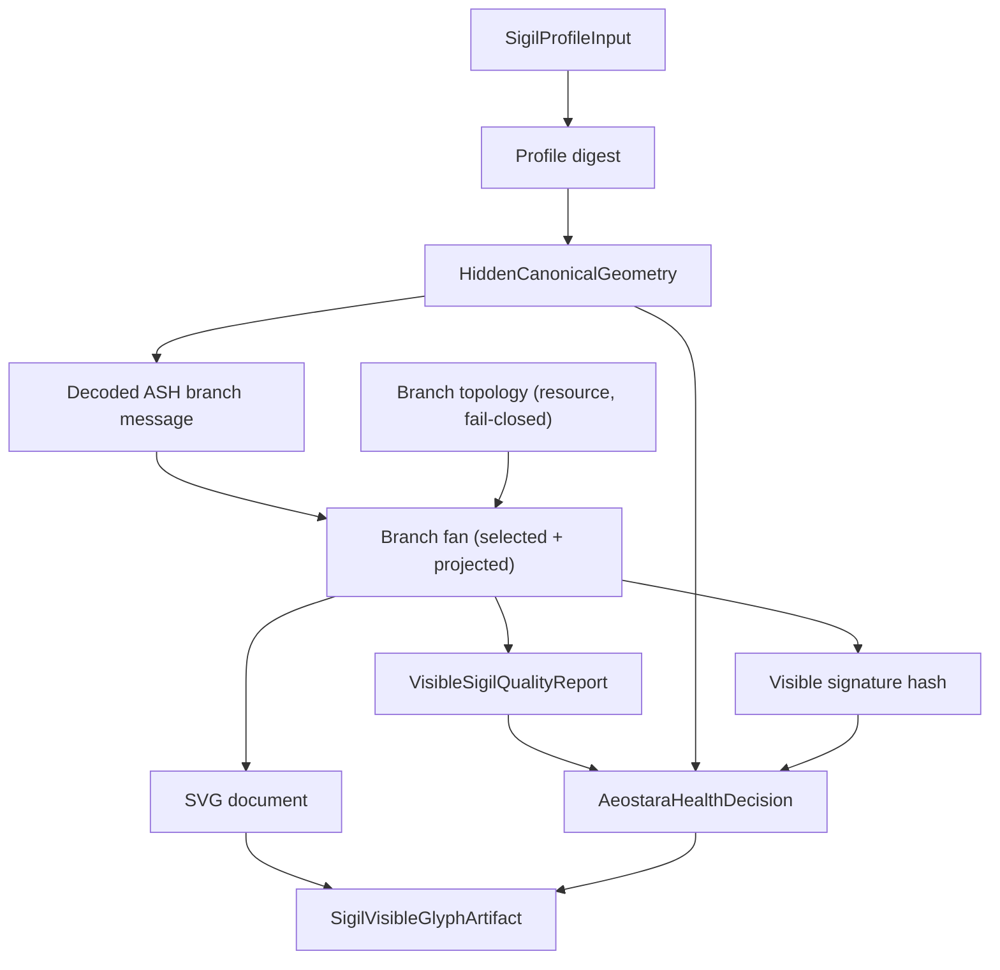
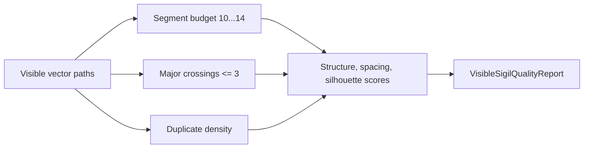

# Visible Glyph Engine

## Scope

`RFSigilVisibleGlyph` implements a bounded local foundation for visible glyph artifacts. It produces deterministic SVG-backed visible sigils from profile input while keeping canonical identity data, visible path data, and presentation styling separate.

This is not the final identity pipeline. It is a local deterministic artifact service with quality gates, collision handling, digest linkage, and fail-closed validation.

## Mathematical Direction And Removed Payload Requirement

The [current project plan](project-plan.md) requires source-backed ASH cosmological mathematics to determine canonical form. `makeHiddenGeometry(for:)` resolves the source-backed ASH state — standard numerology, the finite nine-bit `F2^9` state in the APS native convention, orbit and codeword classification, and wolf balance — under `algorithmIdentity = sigil-identity-pipeline.v1`. The final mathematical glyph materialization (Package 05) is now established: the visible vector paths are a deterministic branch fan projected from the canonical ASH branch topology, selected by the profile's decoded ASH message (see [design/ash-derived-glyph.md](design/ash-derived-glyph.md)).

An additional personal-data carrier, encoder/decoder, or payload-recovery layer is [no longer required](decisions/2026-10-10-no-personal-data-embedding.md). The “payload” descriptions below mean structured in-process values, not a requirement to encode a personal record into a glyph. `HiddenCanonicalGeometry`, digest linkage, local artifact validation, mathematical transforms, and Flare isolation are not removed solely by this decision. No application code or test removal is implied by this documentation change.

## Public Surface

| Type | Purpose |
| --- | --- |
| `SigilProfileInput` | Profile fields used as deterministic input |
| `HiddenCanonicalGeometry` | Local hidden geometry payload linked to a profile digest |
| `SigilFamilyKey` | Reduced routing key for visible shape family decisions |
| `VisibleCanonicalSigil` | Canonical visible path payload and quality report |
| `SigilVisibleGlyphArtifact` | Combined hidden geometry, family key, visible sigil, SVG, and validation decision |
| `SigilVisibleQualityGate` | Structural, spacing, silhouette, crossing, and segment checks |
| `SigilFlarePresentation` | Presentation-only style sidecar that preserves canonical path data |
| `SigilNumerologyRecord` | Standard numerology roots (life path, expression, soul urge, personality, weekday) with master-number preservation and reduction provenance |
| `SigilAshStateRecord` | Source-backed nine-bit ASH state, orbit size, codeword/orbit-member classification, dominant plane, wolf balance, and algorithm identity |
| `SigilProfileAdapterV1` | Named, versioned profile-to-state seam (one parity rule per coordinate; fail-closed on missing identity-core signals) |
| `SigilCoordinateAdapter` | `b6 <-> b7` coordinate seam (involution over the 512 states; commutes with XOR-by-codeword) |
| `SigilBranchTopology` / `SigilBranchNode` | The canonical ASH branch tree (121 nodes / 81 leaves, depth 0-4 full ternary tree); each node carries its 9-bit ASH codeword state, 4-bit message (the codeword index), and 2D segment endpoints |
| `SigilBranchTopologyLoader` | Integrity-verified, fail-closed loader: re-hashes the shipped resource against the manifest and structurally validates the tree (counts, single root, parent links, finite coordinates, `state == codeword`, 16 messages/codewords) |
| `SigilBranchSource` / `SigilBranchManifest` | Product-owned provenance for the branch topology (source SHA-256, pinned source-archive SHA-256, mode, role) |

## Artifact Flow

## Hidden Canonical Geometry

Hidden geometry is derived locally and contains:

- profile hash
- numerology vector (roots, weekday, and reduction provenance)
- source-backed ASH state record (`sigil-ash-state.v1`: packed nine-bit state, bits, orbit size, codeword/orbit-member classification, dominant plane, wolf balance)
- plane attunement vector
- wolf balance
- ancestry weights
- celestial class basis
- anchor points
- semantic edges
- semantic roles
- canonical geometry digest

The hidden geometry carries `algorithmIdentity = sigil-identity-pipeline.v1`; the embedded state record carries `sigil-ash-state.v1`. No digest bytes substitute for the semantic state. The visible artifact references hidden geometry by digest, and hidden geometry is not encoded as visible path IDs. The visible path synthesis is now the **canonical ASH branch geometry** (Package 05): a deterministic branch fan projected from the shipped branch topology and selected by the decoded ASH branch message.

## Family Key Derivation

`SigilFamilyKey` reduces hidden geometry into visible-routing decisions:

- life-path root
- preserved master numbers
- dominant plane
- secondary planes
- wolf balance category
- primary ancestry family
- celestial class basis ID

The visible **geometry** is driven by the decoded ASH branch message (not the family key); the family key now influences the presentation layer only — the palette metadata and the semantic motif map.

## Visible Path Synthesis

The service produces a stable vector path set for each candidate index. The visible geometry is the **canonical ASH branch geometry**: a deterministic branch fan selected from the shipped branch topology and projected into the 100x100 viewBox.

Selection is driven by the profile's decoded ASH **branch message** (through the reference-to-APS message seam), not by digest bytes. For a message, the service takes the smallest root-to-leaf ancestor-edge fan within the presentation budget (10...14 strokes) whose **recomputed** segment crossings are within the quality limit (<= 3); sparse channels are completed deterministically from adjacent messages, shifted by the candidate index so collision resolution changes the geometry. Each emitted stroke carries a depth-derived primitive (`dominantSpine`, `upperStructure`, `lowerRoot`, `terminal`), a `branch_depthN` stroke role, and a branch-message semantic source.

Visible paths are capped at 14 segments and must satisfy the quality gate before an artifact is returned.

## Quality Gate

The gate fails closed for:

- empty path set
- segment budget below 10
- segment budget above 14
- major crossing count above 3
- excessive duplicate path density

Passing reports must clear structural, spacing, and silhouette score thresholds.

## Collision Handling

Visible signatures are checked against an optional existing signature set. If a candidate collides or fails quality, the service advances deterministically to the next candidate index. The current search window is 64 candidates.

## Validation

Artifact validation requires:

- visible profile digest matches hidden profile hash
- visible geometry digest matches hidden canonical geometry digest
- visible quality report passed

Validation returns an `AeostaraHealthDecision`. Digest or quality mismatch returns blocked status, disallows mutation, requires backup before mutation, requires verification after execution, and requires operator review.

## Presentation Boundary

`SigilFlarePresentation` can carry alternate palette, glow, or background metadata. It does not change:

- profile digest
- canonical geometry digest
- visible signature hash
- vector paths

This keeps canonical identity and presentation style separate.

## Golden Fixture Evidence

| Fixture | Signature prefix | Path signature prefix | Segments | Major crossings | Candidate |
| --- | --- | --- | ---: | ---: | ---: |
| `golden_mortal_a` | `e38d4ad28741` | `6dbb7aa5162e` | 13 | 2 | 0 |
| `golden_mortal_b` | `518e517d7aff` | `0d976a83a569` | 14 | 3 | 0 |
| `golden_mortal_c` | `60bfa9395601` | `d0198f4e3a19` | 13 | 3 | 0 |
| `golden_mortal_d` | `441d655e515a` | `cf2491ac4bc3` | 11 | 2 | 0 |

The fixture SVGs and snapshot summary live in `ProjectEvidence/visible-glyph-snapshots/`. All four golden-profile states are orbit members (none is a codeword); their packed nine-bit ASH states are 108, 435, 183, and 249 respectively (a = balanced wolf, b and c = dark-dominant, d = white-dominant).

## Test Coverage

`VisibleGlyphGenerationTests` covers:

- deterministic hidden and visible artifact generation
- stable canonical JSON and SVG rendering
- uniqueness across golden profiles
- quality gate pass behavior
- presentation style invariance
- rejection of scribble-like output
- deterministic collision resolution
- fail-closed validation for digest mismatch

`IdentityPipelineTests` (Package 02) covers: independently computed spec fixtures, letter normalization and numerology roots, weekday reduction, master-number preservation, wolf categories, fail-closed input classes, the 512/16 codeword set and coordinate-adapter invariants, and the ASH state record.
