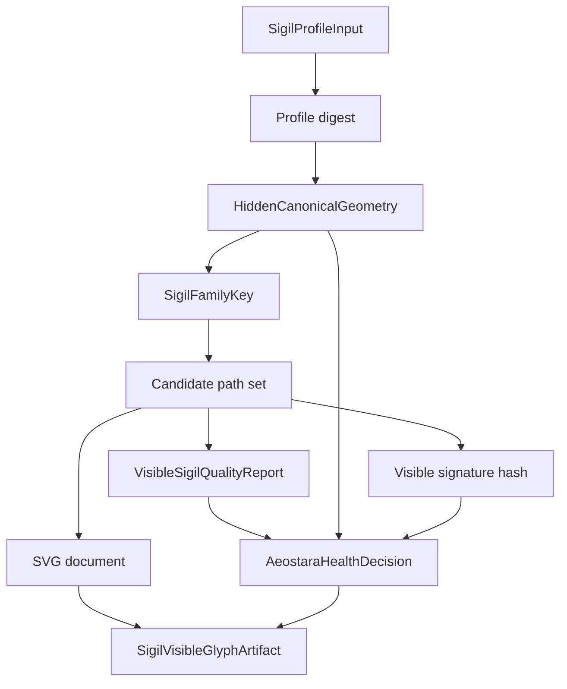
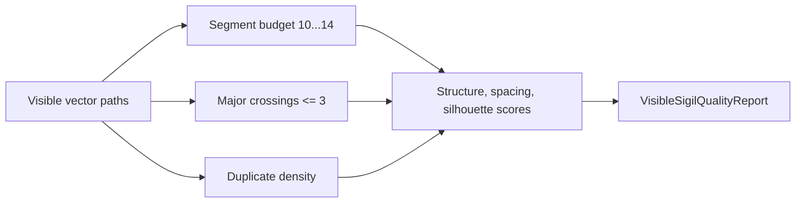

# Visible Glyph Engine

## Scope

`RFSigilVisibleGlyph` implements a bounded local foundation for visible glyph artifacts. It produces deterministic SVG-backed visible sigils from profile input while keeping canonical identity data, visible path data, and presentation styling separate.

This is not the final identity pipeline. It is a local deterministic artifact service with quality gates, collision handling, digest linkage, and fail-closed validation.

## Mathematical Direction And Removed Payload Requirement

The [current project plan](project-plan.md) requires source-backed ASH cosmological mathematics to determine canonical form. `makeHiddenGeometry(for:)` currently derives local values using profile digests; naming its result a stabilized state does not establish the final ASH resolver. The approved source trace must map these outputs to governing mathematics, canonical data, and applicable binary artifacts before a formula change.

An additional personal-data carrier, encoder/decoder, or payload-recovery layer is [no longer required](decisions/2026-10-10-no-personal-data-embedding.md). The “payload” descriptions below mean structured in-process values, not a requirement to encode a personal record into a glyph. `HiddenCanonicalGeometry`, digest linkage, local artifact validation, mathematical transforms, and Flare isolation are not removed solely by this decision. No application code or test removal is implied by this documentation change.

## Public Surface

| Type | Purpose |
| --- | --- |
| `SigilProfileInput` | Profile fields used as deterministic input |
| `HiddenCanonicalGeometry` | Local hidden geometry payload linked to a profile digest |
| `SigilFamilyKey` | Reduced routing key for visible shape family decisions |
| `VisibleCanonicalSigil` | Canonical visible path payload and quality report |
| `SigilVisibleGlyphArtifact` | Combined hidden geometry, family key, visible sigil, SVG, and validation decision |
| `SigilVisibleQualityGate` | Structural, spacing, silhouette, crossing, and segment checks |
| `SigilFlarePresentation` | Presentation-only style sidecar that preserves canonical path data |

## Artifact Flow

## Hidden Canonical Geometry

Hidden geometry is derived locally and contains:

- profile hash
- numerology vector
- stabilized state digest
- plane attunement vector
- wolf balance
- ancestry weights
- celestial class basis
- anchor points
- semantic edges
- semantic roles
- canonical geometry digest

The visible artifact references hidden geometry by digest. Hidden geometry is not encoded as visible path IDs.

## Family Key Derivation

`SigilFamilyKey` reduces hidden geometry into visible-routing decisions:

- life-path root
- preserved master numbers
- dominant plane
- secondary planes
- wolf balance category
- primary ancestry family
- celestial class basis ID

This key influences stroke selection, ornaments, path roles, palette metadata, and candidate structure.

## Visible Path Synthesis

The service produces a stable vector path set for each candidate index. The baseline visible structure includes:

- dominant spine
- upper left and right crown structure
- shoulder paths
- central nexus crossing paths
- lower root paths
- terminal stroke
- internal division stroke
- optional side ornaments
- optional master-number accent

Visible paths are capped at 14 segments and must satisfy the quality gate before an artifact is returned.

## Quality Gate

The gate fails closed for:

- empty path set
- segment budget below 10
- segment budget above 14
- major crossing count above 3
- excessive duplicate path density

Passing reports must clear structural, spacing, and silhouette score thresholds.

## Collision Handling

Visible signatures are checked against an optional existing signature set. If a candidate collides or fails quality, the service advances deterministically to the next candidate index. The current search window is 64 candidates.

## Validation

Artifact validation requires:

- visible profile digest matches hidden profile hash
- visible geometry digest matches hidden canonical geometry digest
- visible quality report passed

Validation returns an `AeostaraHealthDecision`. Digest or quality mismatch returns blocked status, disallows mutation, requires backup before mutation, requires verification after execution, and requires operator review.

## Presentation Boundary

`SigilFlarePresentation` can carry alternate palette, glow, or background metadata. It does not change:

- profile digest
- canonical geometry digest
- visible signature hash
- vector paths

This keeps canonical identity and presentation style separate.

## Golden Fixture Evidence

| Fixture | Signature prefix | Path signature prefix | Segments | Major crossings | Candidate |
| --- | --- | --- | ---: | ---: | ---: |
| `golden_mortal_a` | `d1c449480681` | `325751febea0` | 11 | 2 | 0 |
| `golden_mortal_b` | `a30f0637d20e` | `0fa74b57db6f` | 12 | 3 | 0 |
| `golden_mortal_c` | `fe6ad030656d` | `3a3164751a4f` | 12 | 3 | 0 |
| `golden_mortal_d` | `1f83673aa6ff` | `17ea3da2c04c` | 12 | 2 | 0 |

The fixture SVGs and snapshot summary live in `ProjectEvidence/visible-glyph-snapshots/`.

## Test Coverage

`VisibleGlyphGenerationTests` covers:

- deterministic hidden and visible artifact generation
- stable canonical JSON and SVG rendering
- uniqueness across golden profiles
- quality gate pass behavior
- presentation style invariance
- rejection of scribble-like output
- deterministic collision resolution
- fail-closed validation for digest mismatch
